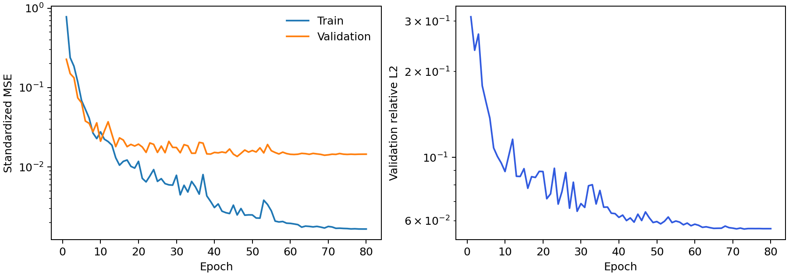
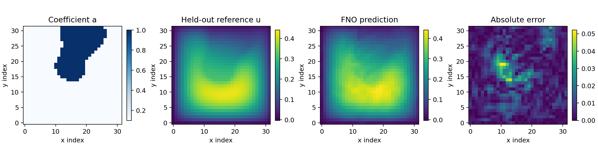
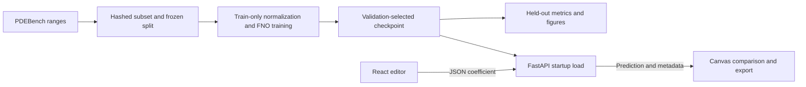

# FLOWFORGE

**Neural PDE Solver | Darcy Flow**

FLOWFORGE is a scientific ML application for constructing a spatial permeability
field and predicting a Darcy flow solution with a Fourier neural operator (FNO).
It includes a genuine PDEBench subset, training from random initialization,
validation-based checkpoint selection, held-out evaluation, a FastAPI service,
and an interactive React workspace. Predictions are learned approximations with
explicit limits, rather than exact general-purpose PDE solutions.

**Live app:** [Open FLOWFORGE](https://ujjwal75-flowforge-darcy-2026.hf.space)
· [Public source Space](https://huggingface.co/spaces/ujjwal75/flowforge-darcy-2026).
Verified on **4 November 2026** with anonymous API checks and all six real browser
tests. The main workspace/API use CPU; the auxiliary `/benchmark` uses an
on-demand GPU and free daily ZeroGPU quota. See the
[deployment evidence](docs/results/deployment.json) and
[actual public browser capture](docs/results/workspace.png).

## Run the application

Python 3.11 or 3.12, Node 22, npm and uv are supported. The final 2.7 MiB checkpoint
and six attributed test examples are versioned, so **running the app does not
require downloading the training dataset or retraining**.

```bash
uv venv --python 3.11 .venv
UV_CACHE_DIR=.cache/uv uv pip sync --python .venv/bin/python requirements.lock
npm ci --prefix frontend
npm run build --prefix frontend
make serve
```

Open <http://127.0.0.1:7860>. On Linux without a GPU, install the CPU PyTorch wheel
first, then use `uv pip install -r requirements.lock` instead of `sync` so its
`2.8.0+cpu` local version is retained:

```bash
uv pip install --python .venv/bin/python torch==2.8.0 --index-url https://download.pytorch.org/whl/cpu
uv pip install --python .venv/bin/python -r requirements.lock
```

Without uv, use `python3.11 -m venv .venv` and
`.venv/bin/python -m pip install -r requirements.lock` (or install the Linux CPU
wheel first using pip with the same official index).

The workspace loads a held-out example without automatically predicting. Select
another example, choose an exploratory preset, or paint a binary coefficient
field. Arrow keys move the editor cursor; Space/Enter paints. Editing clears the
reference identity. Reset restores the selected source. Run the model, inspect
the shared prediction/reference scales, and download JSON or long-form CSV.

## The scientific problem

The selected PDEBench shard uses Darcy beta=1 on the unit square:

\[
-\nabla\cdot(a(x,y)\nabla u(x,y))=1,\qquad (x,y)\in[0,1]^2.
\]

The coefficient `a` takes values **0.1 and 1.0** in the source data. The generator
thresholds sums of five Gaussian inclusions. Its flux-based diffusion evolution
with constant source approaches a steady field; the inspected configuration has
final time 2.0. The stored dataset solution is our reference. We do not claim a
new continuum convergence certificate.

The upstream helper called `bc_2D(..., mode="Neumann")` **sets exterior ghost
values to zero**. This implementation detail is documented explicitly: the
stored 128×128 values are interior cell centers, whose edge rows need not be
zero. The FNO does not hard-enforce this boundary behavior. The archive supplies
no SI pressure calibration, so outputs use **dataset solution units**.

See the [dataset audit](docs/data-audit.md) for the inspected generator, boundary
helper, configuration, source-array metadata and alternative-loader investigation.

## Dataset and preprocessing

- **Source:** Takamoto et al., *PDEBench Datasets* (2022),
  [DOI 10.18419/darus-2986](https://doi.org/10.18419/darus-2986), CC BY 4.0.
- **Exact shard:** `2D_DarcyFlow_beta1.0_Train.hdf5`, public file ID **133219**;
  `nu`: `[10000,128,128]`, `tensor`: `[10000,1,128,128]`, float32.
- **Cohort:** source sample indices **0–1023**, downloaded through bounded HTTP
  ranges (134,287,752 bytes transferred), not the full 1.31 GB shard.
- **Spatial representation:** `[:, ::4, ::4]` without interpolation, yielding
  32×32 fields; the original coordinate arrays receive the identical slice.
- **Partition:** NumPy `default_rng(42).permutation(1024)`: first **800 train**,
  next **112 validation**, last **112 test**. Indices are saved in
  [split.json](artifacts/darcy-fno/split.json). Duplicate coefficient fingerprints
  are checked across partitions.
- **Normalization:** one scalar mean and population standard deviation per
  variable, fitted only to training pixels. Apply `(a-mean_a)/std_a`; decode the
  predicted standardized solution with `u=z*std_u+mean_u`. The same wrapper is
  used by training evaluation, CLI inference, and the API.
- **Coordinates:** arrays remain `field[x_index][y_index]`; tensors are
  `[batch,1,x,y]`. The FNO internally adds its normalized index-grid embedding.
  Canvas maps x horizontally and y upward. Matplotlib uses an explicit `.T`
  only for Cartesian rendering. Exports retain x-major arrays and original
  sampled physical coordinates.

The full-shard MD5 is published as `81694ed31306ff2e5f6b76349b0b4389` but is
**not claimed verified**: only bounded ranges were fetched. Exact HTTP ranges
and lengths are checked, and the prepared arrays have recorded SHA-256 hashes
in [dataset.json](artifacts/darcy-fno/dataset.json). Raw data remain ignored.
Six test pairs are redistributed with source indices and attribution under
CC BY 4.0. Subsampling and preprocessing are the documented modifications.

The official `load_darcy_flow_small` API was successfully smoke-tested. Its tiny
archive contains processed targets without a supplied inverse physical-unit
transform, so the raw PDEBench shard was selected instead of inventing one.

## Model and measured experiment

The maintained **neuraloperator 2.0.0** implementation supplies the real FNO:
four Fourier blocks, 32 hidden channels, `n_modes=(12,12)`, one coefficient input
channel, one solution output channel, built-in grid embedding and projection
channel ratio 2. Other architecture defaults are fixed by the pinned package.
Global Fourier mixing is appropriate for the nonlocal coefficient-to-solution
mapping; local nonlinear channel transformations complement it.

Training used PyTorch **2.8.0**, float32, CPU with two PyTorch threads, on an
ARM64 macOS machine with eight logical CPUs and 8 GiB RAM. Seed **42**, batch size **32**,
**80 epochs**, AdamW with learning rate **0.003**, weight decay **1e-4**,
cosine decay and gradient clipping at norm **1.0**. The objective is standardized
MSE, with no PDE residual term, output clipping or boundary projection.

Training took **1,146.09 seconds (19.1 minutes)**. Validation mean relative L2
selected **epoch 73**, before final test evaluation. The model has **701,281
independent real scalar parameters** (complex parameters count twice).

| Final 112-sample test metric | FNO | Pixelwise training-mean baseline |
| --- | ---: | ---: |
| Mean relative L2 | **0.0617681** | 0.5753512 |
| MSE | **0.000435679** | 0.013103231 |
| MAE | **0.010755231** | 0.077857603 |

MSE and MAE average all test pixels in decoded dataset units. Relative L2 is
`mean_n(norm(pred_n-ref_n)/max(norm(ref_n),1e-12))`, not a ratio of aggregate
batch norms. The baseline uses the mean training solution at each pixel and
the identical test split, without access to test labels during fitting.

Reloaded, warmed batch-one inference had **3.68 ms median / 4.29 ms p95** over
100 timed calls after 10 warm-ups, on ARM64 CPU with two threads. It includes
the model wrapper's preprocessing/forward/decode and excludes network, queueing,
JSON and rendering. The UI separately reports actual serving and round-trip
times, which vary by machine and load. No numerical-solver speedup is claimed.





The qualitative example is the first entry of the frozen test split; it was
not selected for visual quality. Prediction/reference share a color scale.
Machine-readable [configuration](artifacts/darcy-fno/config.json),
[history](artifacts/darcy-fno/history.json) and
[evaluation](artifacts/darcy-fno/evaluation.json) accompany the checkpoint.

## Reproduce the research pipeline

Install development dependencies with `uv pip sync --python .venv/bin/python
requirements-dev.lock`. These include the optional hosting adapter and tests.

```bash
make data                         # bounded official download; reuse verified local arrays
make inspect                      # shape, ranges and source hashes
make smoke                        # official small-loader/FNO forward/backward test
make train                        # writes a fresh artifacts/reproduction experiment
make evaluate                     # reloads it, evaluates test and exports figures
```

The tiny-loader smoke test still retrieves public Zenodo metadata when its
data are local; it needs network access. The principal PDEBench pipeline does
not depend on that tiny dataset. For a fresh tiny-loader test, obtain the 1 MB
`darcy_16.tgz` archive from the linked NeuralOperator record and extract its two
`.pt` tensors into `data/`, or let its documented loader download them.

Training refuses to overwrite an existing checkpoint. Choose another directory
for another experiment: `make train EXPERIMENT=artifacts/run-2` and
`make evaluate EXPERIMENT=artifacts/run-2`. To evaluate the included checkpoint:

```bash
MPLCONFIGDIR=.cache/matplotlib .venv/bin/python -m ml.pipeline evaluate --artifact artifacts/darcy-fno
```

For single CLI inference, create an input from a bundled example and predict:

```bash
.venv/bin/python -c 'import json; from pathlib import Path; x=json.loads(Path("artifacts/darcy-fno/examples.json").read_text())[0]; Path("artifacts/input.json").write_text(json.dumps({"coefficient":x["coefficient"]}))'
.venv/bin/python -m ml.pipeline predict --input artifacts/input.json --output artifacts/prediction.json
```

The checkpoint is [best.pt](artifacts/darcy-fno/best.pt), SHA-256
`f711c406ba83cee285f97adf2cd067c803e4d915753ee613e5f2639c727265e5`.
It contains tensor weights only. The loader verifies its hash, reconstructs the
FNO from JSON, and uses `torch.load(weights_only=True)` with strict state loading.
Intermediate experiments, caches, raw data and full test predictions stay ignored.

## Architecture and API



| Endpoint | Contract |
| --- | --- |
| `GET /api/health` | Service status, model readiness/version and CPU device |
| `GET /api/model-info` | PDE, shapes, source, transforms, actual metrics and limitations |
| `GET /api/examples` | Six small reference descriptors without full arrays |
| `GET /api/examples/{id}` | Held-out coefficient/reference pair and source index |
| `GET /api/training-history` | Actual per-epoch records |
| `POST /api/predict` | `coefficient`: 32×32 numeric array; optional `example_id` |

An example request can be generated from the running service:

```bash
curl -fsS http://127.0.0.1:7860/api/examples/test-01 > artifacts/example.json
.venv/bin/python -c 'import json; from pathlib import Path; x=json.loads(Path("artifacts/example.json").read_text()); Path("artifacts/request.json").write_text(json.dumps({"coefficient":x["coefficient"],"example_id":x["id"]}))'
curl -fsS -H 'Content-Type: application/json' --data-binary @artifacts/request.json http://127.0.0.1:7860/api/predict > artifacts/response.json
```

The response contains `prediction`, `shape`, `array_layout`, `inference_ms`,
checkpoint/version, numeric summary and warnings. It includes reference,
absolute-error and comparison fields only for an unchanged named test example.
Custom input has no ground-truth claim. CSV exports are long form, with x/y
indices, original coordinates, input, prediction and optional reference/error.

Inputs reject wrong dimensions, numeric strings, booleans, non-finite numbers,
extra keys and values outside `[0.1,1]`. Intermediate coefficients are accepted
with an out-of-distribution warning. Request bodies are capped at 64 KiB,
including chunked bodies. Unready/busy models return 503; malformed input 422;
oversized bodies 413. Model calls run off the event loop under a bounded lock.
No Python objects, uploads or server paths are accepted. The frontend/API share
an origin, with no CORS wildcard. Predictions are transient unless downloaded.

## Verification and Docker

```bash
make test
npm run build --prefix frontend
PLAYWRIGHT_BROWSERS_PATH="$PWD/.cache/ms-playwright" frontend/node_modules/.bin/playwright install chromium --only-shell
# With the application running:
PLAYWRIGHT_BROWSERS_PATH="$PWD/.cache/ms-playwright" npm run test:e2e --prefix frontend
docker compose up --build -d
```

The browser configuration uses its matching headless Chromium with software
rendering. `PLAYWRIGHT_CHROME_PATH` can explicitly select another compatible
browser. System Chrome 156 stalled at GPU initialization on this machine; the
matching headless browser passed the real interaction checks.

The Docker build uses Node for static assets, then a non-root Python runtime
with CPU-only PyTorch and cached `uv 0.10.8` dependency installation. It includes
the trained artifact and six examples, not the raw dataset. Port 7860,
one worker and two inference threads are the defaults. The healthcheck verifies
model readiness. See [verification](docs/verification.md) for final check results
and [deployment](docs/deployment.md) for the verified hosting record.

Configuration is shown in [.env.example](.env.example); the server reads the
environment directly. Production does not need credentials or external inference.
Vite is the permitted frontend fallback: this client needs no SSR, and static
assets avoid a second Node runtime in the small same-origin service.

## Limits and acknowledgements

This evidence concerns a small custom cohort from one Darcy shard. It establishes
no full-benchmark result, cross-resolution accuracy, generalization to different
physics, or guarantee for hand-drawn fields. Spatial subsampling loses fine
structure. The FNO can predict negative values and does not enforce boundary
conditions or conservation. Presets are exploratory inputs with no reference
solve. A larger cohort, numerical residual analysis, uncertainty calibration and
physics constraints are useful future experiments, rather than completed claims.

Data acknowledgement: Makoto Takamoto, Timothy Praditia, Raphael Leiteritz,
Dan MacKinlay, Francesco Alesiani, Dirk Pflüger and Mathias Niepert, *PDEBench:
An Extensive Benchmark for Scientific Machine Learning* (2022).
[Dataset DOI](https://doi.org/10.18419/darus-2986),
[repository](https://github.com/pdebench/PDEBench),
[paper](https://arxiv.org/abs/2210.07182),
[CC BY 4.0](https://creativecommons.org/licenses/by/4.0/).

Model acknowledgement: Li et al., *Fourier Neural Operator for Parametric Partial
Differential Equations*, [paper](https://arxiv.org/abs/2010.08895), and the
[NeuralOperator implementation/docs](https://neuraloperator.github.io/stable/).
Third-party packages retain their respective licenses. See
[experiments](docs/experiments.md), [methodology](docs/methodology.md) and
[architecture](docs/architecture.md) for additional details.

Built by Ujjwal Sharma for the QUEST Lab Full Stack AI Pre-doctoral application.
