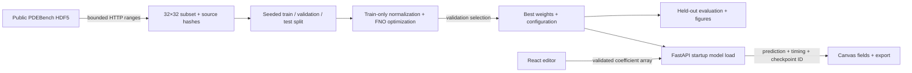

# Architecture

The runtime is one FastAPI process serving the built React client and JSON API
on port 7860. Training is a separate offline command. No database, account system,
external inference provider, or paid compute is required.

## Shared scientific contract

- Arrays are x-major: `field[x_index][y_index]`. Tensor layout is `[batch,1,x,y]`.
- Spatial subsampling uses exactly every fourth cell center of the source grid.
  No array flip, interpolation, coefficient remapping or zero-boundary projection.
- Mean and standard deviation are fitted only on training arrays and stored with
  the checkpoint. The same wrapper normalizes inputs and decodes outputs in
  training evaluation, CLI inference, and the API.
- Positional coordinates are supplied by the maintained FNO's internal grid
  embedding, consistently during training and inference. Its computational grid
  is normalized index space; actual sampled coordinates are returned as metadata.
- Best model selection uses validation relative L2. The held-out test split does
  not enter optimization, normalizer fitting or epoch selection.
- The baseline is the pixelwise mean training solution, evaluated on the identical
  held-out split. It makes no use of test labels or input coefficients.

## Runtime boundaries

Model loading is separate from routes, happens once during lifespan startup, and
uses a trusted local checkpoint with `torch.load(..., weights_only=True)`. Clients
can submit JSON numeric arrays, not model files, Python objects or filesystem paths.
Predict routes run in FastAPI's thread pool; a lock serializes model calls to bound
CPU contention. A bounded body middleware rejects oversized requests before JSON
parsing. Validation errors omit raw request values and internal tracebacks.

The frontend calls relative `/api` URLs. Production uses the same origin and needs
no CORS wildcard. A Vite-only development proxy forwards `/api` to local FastAPI.
The application has no user persistence; a prediction is transient unless the user
downloads its CSV/JSON. Scientific results and model metadata are read-only.

Reference comparisons are available only for bundled, named held-out examples.
The server checks the submitted field against the named reference before returning
an error map. Editing an example clears its reference identity in the client.

## Artifact strategy

Source, dependency locks, training commands, compact measured reports and figures
belong in Git. Raw data, virtual environments, caches and intermediate checkpoints
are ignored. The final checkpoint is only about 2.7 MB, so an explicit allowlist
versions exactly one runtime artifact, its configuration, split indices, history,
evaluation, training-mean baseline and six attributed held-out examples. This makes
the application runnable directly from the repository. It is the checkpoint trained
in this session, not a downloaded pretrained model. Full test predictions remain ignored.

The Docker image includes only the six files needed at runtime and requires no
training dataset or download credentials at startup. SHA-256 links weights to the
configuration and evaluation report. The repository history identifies the final
artifact revision; local retraining remains available through the documented commands.
